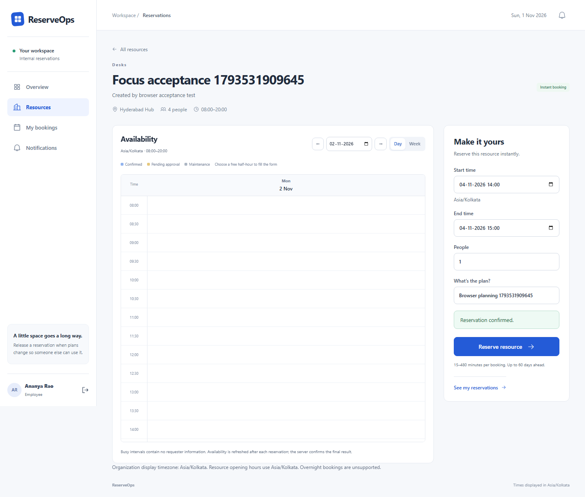

# ReserveOps

Shared spaces. Clear approvals. Reservations that cannot double-book.

ReserveOps is a local-first internal booking application for rooms, individual desks, equipment, and vehicles. Employees reserve or deliberately join a FIFO waitlist; scoped managers approve requests; admins manage inventory, maintenance, locations, and analytics. Every important booking change has an audit timeline and in-app notification. No Docker, external API keys, email provider, hosted auth, or paid services are required.



## Start here

The original instruction pack is preserved one directory above this application. All runnable source is inside this `reserveops/` directory. Verification results and limitations are recorded in [BUILD_STATUS.md](BUILD_STATUS.md); genuine command output is in [docs/evidence](docs/evidence).

### Prerequisites

Tested: Ruby **3.3.13**, Rails **8.1.4**, PostgreSQL **18**, Redis **8.10.3**, Node **22.14.0**, npm **11.19.1**. Ruby gems and npm packages are locked in `backend/Gemfile.lock` and `frontend/package-lock.json`, including Linux and Windows Ruby platforms. React 19.3.1, Vite 8.3.5, Tailwind 4.3.3, Sidekiq 7.3.9, RSpec Rails 8.0.4, Vitest 5.0.5, and Playwright 1.64.1 were installed. Node ≥22.12 on the Node 22 line is required by the frontend tools.

Install Ruby/Bundler (Ruby+Devkit on Windows), Node/npm, PostgreSQL server/client, Redis server and Git. PostgreSQL and Redis must be running before setup. Linux/macOS can use native package managers; Windows can use native Ruby/PostgreSQL and Redis in WSL2, without Docker. See [Windows details and troubleshooting](docs/OPERATIONS.md) for the portable tooling already installed on this build machine.

Create a non-superuser local PostgreSQL app role using an administrator connection:

```sql
CREATE ROLE reserveops LOGIN CREATEDB NOSUPERUSER;
```

Configure authentication through PostgreSQL/your shell; do not put real credentials in Git. `btree_gist` must be available; migrations enable it. CREATEDB is needed for `db:create`, and can be revoked after creating development/test databases.

### Install and seed

From this application directory:

```powershell
# PowerShell (this build machine's portable tools/ports are detected automatically)
$env:DEMO_PASSWORD='ReserveOps-demo-2026!' # local example only; choose your own for a new setup
./scripts/setup.ps1
```

```bash
# Linux/macOS
export DEMO_PASSWORD='choose-a-local-demo-password'
bash scripts/setup.sh
```

For a standard installation, copy `backend/.env.example` to ignored `backend/.env` and adjust `PGHOST`, `PGPORT`, `PGUSER`, `PGPASSWORD`, and `REDIS_URL`. Defaults are PostgreSQL :5432 and Redis :6379. On this build machine, `scripts/local-env.ps1` detects the isolated PostgreSQL :55432 and Redis :56379 installations. `frontend/.env.example` documents the organization display timezone; default is `Asia/Kolkata`. Set backend `APP_TIMEZONE` and frontend `VITE_APP_TIMEZONE` consistently if changing it. Each location separately defines its opening-hour timezone.

Equivalent setup commands:

```bash
cd backend
bundle install
ruby bin/rails db:create db:migrate db:seed
cd ../frontend
npm ci
```

Seeds are repeatable and require the environment-supplied password (minimum 12 characters). They refuse production. First seed creates 6 accounts, 2 locations, 6 resources, and confirmed, pending, waitlisted, cancelled, and completed examples. Seed times are relative to the first run; tests freeze their own clock. Reseeding keeps existing demo history and updates demo passwords.

### Run locally

Open three terminals in the application directory:

```powershell
./scripts/start.ps1 api
./scripts/start.ps1 worker
./scripts/start.ps1 web
```

Or use platform-neutral commands, with configured environment:

```bash
cd backend && bundle exec rails server -b 127.0.0.1 -p 3000 -u webrick
cd backend && bundle exec sidekiq -c 5
cd frontend && npm run dev
```

Open **http://127.0.0.1:5173**. Vite forwards `/api` to Rails :3000. Use the same hostname consistently for cookies. `/api/v1/health` reports DB/Redis readiness. Stop foreground processes with Ctrl+C.

Run `ruby bin/rails maintenance:tick` in `backend/` every minute via cron/Task Scheduler to reconcile late/missed jobs and create daily summaries. On this machine: `./scripts/start.ps1 tick`. Sidekiq schedules per-booking deadlines; it does not automatically schedule recurring sweeps. The build does not install a permanent system scheduler.

### Demo accounts

All use the password you supplied to `DEMO_PASSWORD`. This build's local example password above is for demo use only.

| Email | Role / management scope |
|---|---|
| `ananya@reserveops.local` | Employee |
| `kabir@reserveops.local` | Employee |
| `tara@reserveops.local` | Employee |
| `manager.hyderabad@reserveops.local` | Manager, Hyderabad Hub |
| `manager.bengaluru@reserveops.local` | Manager, Bengaluru Hub |
| `admin@reserveops.local` | Admin, global inventory/analytics |

Follow the [demo walkthrough](docs/DEMO.md) for conflict → waitlist → cancellation → promotion, approvals, and analytics. Employees see only their private booking details; managers require explicit locations; no role can approve its own request.

## Why two people cannot book the same resource

PostgreSQL enforces the invariant even across independent concurrent transactions:

```sql
EXCLUDE USING gist (
  resource_id WITH =,
  tstzrange(starts_at, ends_at, '[)') WITH &&
) WHERE (status IN ('pending_approval', 'confirmed'));
```

Intervals are half-open: 10–11 and 11–12 coexist. Pending approval holds block inventory until the earlier of 24 hours or booking start. A failed insert/reschedule rolls back its events and notifications. Exclusion violations map to HTTP 409; deadlocks receive bounded retries. Occupant capacity limits people, not simultaneous reservations. See [architecture and metric definitions](docs/ARCHITECTURE.md), [six ADRs](docs/adr), [migration](backend/db/migrate/20261101000000_create_reserveops.rb), and [concurrency regression](backend/spec/services/booking_integrity_spec.rb).

## Verify

```powershell
./scripts/check.ps1
$env:DEMO_PASSWORD='ReserveOps-demo-2026!' # match your seed password
./scripts/smoke.ps1
cd frontend
npx playwright install chromium
npm run e2e # API + worker + frontend must be running
```

```bash
bash scripts/check.sh
# Individual checks:
cd backend
RAILS_ENV=test bundle exec rails db:prepare
bundle exec rspec
bundle exec rails zeitwerk:check
bundle exec rubocop
bundle exec brakeman --no-pager --no-threads
cd ../frontend
npm run lint
npm run format:check
npm test
npm run build
DEMO_PASSWORD="$DEMO_PASSWORD" npm run e2e
```

RSpec uses real PostgreSQL, committed fixtures, synchronization barriers and separate checked-out connections. It verifies one 201/one 409, direct SQL rejection, adjacent ranges, rollback, authorization, hold expiry, FIFO promotion races, idempotent jobs, model/DB guards, analytics, and sessions. Vitest/RTL covers forms, permissions, conflict opt-in, calendar, approvals, cancellation, notifications and CSRF bootstrap. Playwright exercises five actual browser workflows, including real Redis/Sidekiq promotion and 360px navigation. Browser captures are actual local app screenshots.

GitHub Actions uses managed PostgreSQL/Redis CI service containers; this does not add a local Docker requirement. The workflow is supplied and locally relevant commands are verified; no remote GitHub run or deployment is claimed.

## Source map and boundaries

- `backend/`: Rails controllers/policies, booking services, migrations, PostgreSQL structure, workers, seeds and RSpec.
- `frontend/`: React JavaScript routes/components, day/week calendar, Tailwind/CSS, component and browser tests.
- `scripts/`: setup, local launch, readiness smoke and quality checks.
- `docs/`: [API contract](docs/API.md), [operations/security](docs/OPERATIONS.md), architecture, ADRs, demo, screenshots and test evidence.

This MVP supports one organization and individually bookable resources, same-day opening hours on all weekdays, and in-app notifications. It has no recurring bookings or external delivery. Analytics uses current hours/blackouts for historical periods. Login throttling is per process, and the Windows Redis port is unofficial. Permanent recurring maintenance, production hardening/hosting, backups and a remote CI run remain operator tasks. See [operations](docs/OPERATIONS.md) before any deployment. No production credentials or API keys are included.

MIT license; third-party dependencies retain their own licenses. ReserveOps is a personal project, not a claim of professional employment or production usage.
