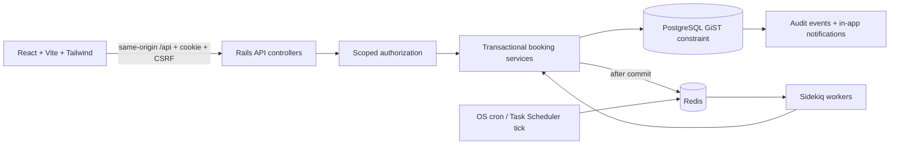

# Architecture and operational rules

Rails uses API controllers plus explicitly installed cookie/session and CSRF middleware. Framework components are declared individually in Gemfile to avoid unused email, storage, cable, and frontend frameworks. This is a Rails 8.1 application, using `railties`, `actionpack`, `activerecord`, and `activejob`. WEBrick is a portable local development server; use a maintained multiworker Rack server and TLS reverse proxy for production.

Each resource is one inventory unit. `pending_approval` and `confirmed` participate in `no_active_resource_overlap`. An insert/update against a conflicting committed or concurrent active range fails with PostgreSQL SQLSTATE `23P01`. `BookingEngine` rescues outside the failed transaction, returning 409. Deadlocks/serialization failures receive at most three attempts; unexpected constraints/errors propagate. A failed booking never leaves an audit event or notification.

Resource shared locks coordinate creates/reschedules with exclusive policy/blackout changes. Creates can still race with each other: correctness comes from GiST. Waitlist passes take an exclusive resource lock and process candidates by `(created_at,id)` with per-candidate savepoints. Busy or policy-ineligible intervals retain their position; past/inactive-user requests expire. A direct reservation may win ahead of a waiting candidate before promotion obtains its lock; FIFO is among eligible waiting requests at promotion time, not a prohibition on direct bookings.

All transitions lock and reload the booking. Final records are immutable through the model. Cancellation after start and rescheduling started records are prohibited; completion occurs only after end. Rescheduling a confirmed request into an approval-required resource policy returns it to pending, with a new deadline. Pending TTL defaults to 24 hours, capped at start; the approval endpoint independently releases stale holds even if workers are late.

Notifications are in PostgreSQL and have a unique `(user_id,notification_key)` index. Every service transition records an event and notification atomically. After-commit scheduling writes only to Redis. Queue failures are logged as `queue_unavailable`; committed reservations remain successful, and `maintenance:tick` reconciles overdue state/reminders/promotions and daily summaries. Run the tick every minute. Sidekiq alone does not create recurring sweeps. Jobs have five retries, then enter Sidekiq's dead set; inspect local logs, repair the cause, and invoke the sweep. No email/network notifications occur.

## Analytics

- Window `[from,to)`, UTC boundaries supplied by the UI from organization-local dates; max 93 days.
- Per-resource denominator: intersection of daily location-local opening hours with reporting window, subtracting the union of blackouts. All seven weekdays count. DST follows IANA timezone rules. Overnight opening hours are unsupported.
- Numerator: union of confirmed/completed occupancy intersected with remaining bookable intervals, clipped to the window. Pending holds are excluded. Zero bookable minutes gives `null`, shown as “No bookable hours”.
- Booking volume: direct submissions (`created` event), created inside the window. Cancellation rate: currently cancelled direct submissions divided by that same cohort. Initial waitlist requests are excluded; the cohort can change as reservations are cancelled later.
- Approval turnaround: mean `decided_at-created_at` minutes for decisions in the reporting window, including rejection. Promotion turnaround includes original waiting time. Rescheduling clears previous decision fields; the audit history remains.
- Historical utilization uses current resource hours/blackout policy, not versioned historical schedules. This MVP limitation is explicit.

## Security and scale boundaries

Employees see only their own private booking/notification details. Managers additionally see/action bookings in explicitly assigned locations. Admins have global inventory/analytics access. No one can approve or reject their own request. Password hashing uses bcrypt; production cookies are Secure/HttpOnly/SameSite=Lax. Logging out increments `session_version`, revoking all account cookies; password change/deactivation also revokes them. Login rate limiting is per-process MemoryStore, not a distributed account lockout. A production multi-process deployment should use a shared limiter. The frontend coalesces CSRF bootstrap requests and fetches a fresh token after logout; no tokens are stored in localStorage.

This is a single-organization local-first MVP. No recurring reservations, overnight hours, pool quantity inventory, external integrations, or live push. Screens refresh on navigation/actions; approvals/notifications include refresh buttons. Catalog and calendars are database-backed. Analytics spans up to 93 days, calculated synchronously in Ruby over scoped SQL results; profile before larger deployments.
